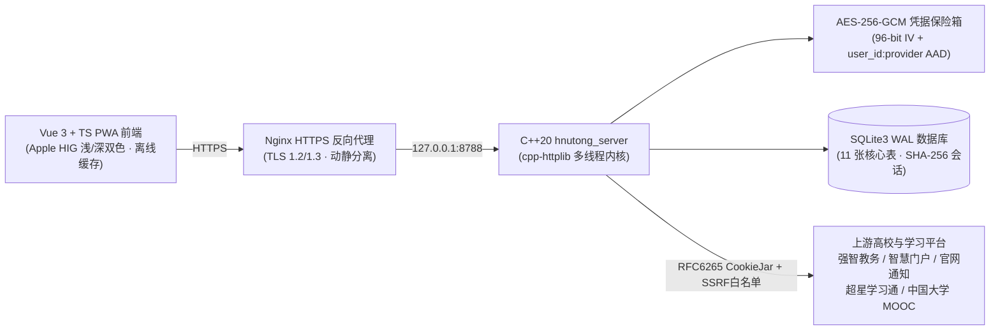

<div align="center">

# HNU-Helper（海大通）

**海南大学校园一体化服务系统 · C++20 原生高性能后端 + Vue 3 / TypeScript 前后端分离 PWA**

[](https://github.com/viii681/HNU-Helper/actions/workflows/ci.yml)
[](./backend)
[](./frontend)
[](./backend/sql/schema.sql)
[](./LICENSE)
[](./LICENSE-ZH.md)

[核心特性](#核心特性一览) · [系统架构](#系统架构) · [快速本地启动](#快速本地启动5-分钟体验) · [Linux 上云部署](./deploy/DEPLOY_LINUX.md) · [发布说明](./docs/RELEASE_NOTES_v1.0.0.md) · [非商业许可声明](#开源协议与非商业严正声明)

</div>

---

> [!IMPORTANT]
> **完全开源 · 严禁任何商业用途与盈利声明**
>
> 本项目基于 **[PolyForm Noncommercial License 1.0.0](./LICENSE)** **完全开源**，全部后端、前端、数据库与部署脚本代码均向个人学习与校园公益社区免费开放。
> **严禁任何个人、团队或机构将本项目（含全部或部分源码、编译产物及衍生版本）用于任何商业用途或盈利行为**——包括但不限于售卖源码/成品、收费查询服务、VIP 会员收费、付费代部署、广告流量变现及商业外包集成。详见 **[中文许可声明 (LICENSE-ZH.md)](./LICENSE-ZH.md)**。

---

## 项目简介

**HNU-Helper（海大通）** 是一套面向 **海南大学（Hainan University）** 学子打造的开源校园一体化服务系统，使用 **C++20** 原生实现全部后端服务、AES-256-GCM 加密体系、RFC 6265 多域 HTTP/Cookie 会话引擎、异步学习平台扫描器与 SQLite WAL 数据持久化，并针对海南大学 11 节制教学作息与五校区双院制生活场景进行了深度定制，支持直接编译部署至 Linux 云服务器并通过自有域名 + HTTPS 对外提供公益服务。

---

## 系统架构



---

## 核心特性一览

| 模块 | 核心能力 |
| :--- | :--- |
| **C++20 原生后端内核** | 零 Python/Node 服务端运行时依赖；`cpp-httplib` 多线程 + `SQLite3 (WAL)` + `OpenSSL/libcurl`（Windows 自动切换 `WinHTTP + CNG BCrypt`） |
| **纵深安全与隐私保护** | **AES-256-GCM**（独立随机 96-bit IV + `user_id:provider` AAD 防串号）凭据加密；**SHA-256** 会话哈希落库；多用户会话/缓存/进度强隔离 + SSRF 白名单 + 双层 PII 脱敏 |
| **海南大学强智教务** | 原生适配 `https://jxgl.hainanu.edu.cn/jsxsd/`（`LoginToXkLdap` / `encodeInp`、图形验证码、11 节课表 `#kbtable` 解析、成绩绩点、期末考场、培养方案学分核对与五校区空教室查询） |
| **五校区与 17 书院作息** | 内置海甸 / 儋州 / 观澜湖 / 城西（早第一节 `07:40–08:25`，晚第十一节 `21:10–21:55`）与三亚崖州湾作息预设，支持 5 大校区与 17 个书院身份展示及手动校准 |
| **实时通知与台风置顶** | 实时聚合海南大学本科生院与主站 6 大通知源，自动识别**台风预警、停课调休、停水停电**置顶高亮，自动过滤无关招标公告 |
| **海大宿舍电量管家** | 按书院楼栋绑定电表度数与海口空调季日均耗电估算，提供剩余可用天数折算、低电量提醒、寝室购电分摊台账与一键购电跳转 |
| **独立智慧门户认证** | 完整保留二次算术验证码安全页与「首次存密、过期仅需算一道算术题免重输密码重连」机制（算错绝不误删已存密码），支持一卡通流水与 19 项网办单点换票 |
| **多学习平台异步扫描** | 内置 **超星学习通**（课表白名单异步扫描 + 否定词优先防漏判红线）与 **中国大学 MOOC**（Cookie 加密托管扫描），预留 **雨课堂、智慧树、知到** 标准 API 槽位 |
| **PWA 与 `.ics` 日历订阅** | 严守 Apple HIG 浅/深双色规范，提供令牌化 RFC 5545 `.ics` 日历订阅流，支持 iOS / Android / 鸿蒙系统日历与锁屏小组件同步 |

---

## 工程目录结构

```text
.
├── .github/                        # GitHub Actions CI 自动构建测试 + Issue/PR 模板
├── backend/                        # C++20 后端核心工程
│   ├── CMakeLists.txt              # 跨平台 CMake 构建脚本 (Linux OpenSSL+libcurl / Windows WinHTTP+CNG)
│   ├── config/
│   │   ├── config.example.json     # 服务端配置模板
│   │   └── hnu_seed.sql            # 海南大学 11节作息、五校区书院、2026-2027校历与海大指南种子脚本
│   ├── sql/
│   │   └── schema.sql              # SQLite3 WAL 数据库完整建表与索引脚本 (11张核心表)
│   ├── include/hnu/                # 模块化头文件 (app / crypto / db / net / adapters / services / http / utils，含 json_safe.hpp)
│   ├── src/                        # C++20 业务逻辑实现与 main.cpp 入口
│   ├── tests/
│   │   └── test_all.cpp            # C++20 核心加密、解析器、数据库与多用户隔离单元测试套件 (13大套件)
│   └── third_party/                # 内置头文件库 (cpp-httplib, nlohmann/json, sqlite3 amalgamation)
├── frontend/                       # Vue 3 + TypeScript + Vite + Pinia 前后端分离前端工程
│   ├── public/                     # PWA manifest.webmanifest 与矢量图标
│   └── src/
│       ├── api/client.ts           # 统一 REST 客户端与前端第一道日志脱敏器
│       ├── stores/app.ts           # Pinia 全局状态、离线秒开缓存与实时进度/课表聚合
│       ├── styles/apple-hig.css    # Apple HIG 浅深双色设计系统
│       └── components/             # 五大主模块视图 + SyncProgressBar.vue 实时同步进度条
├── deploy/                         # Linux 云服务器生产部署套件
│   ├── DEPLOY_LINUX.md             # Linux 云服务器部署完整操作手册 (域名/HTTPS/Nginx/Systemd/热备)
│   ├── nginx/hnutong.conf          # Nginx HTTPS 反向代理与动静分离配置
│   ├── systemd/hnutong.service     # Systemd 沙盒加固守护进程配置
│   └── scripts/                    # 依赖安装、一键构建、数据库初始化与热备、冒烟验收脚本
├── docs/                           # 完整工程交付文档与发布说明
│   ├── API.md                      # 前后端 RESTful 接口规范文档
│   ├── USER_GUIDE.md               # 海南大学学生与管理员使用说明
│   ├── TEST_VERIFICATION.md        # 编译、单元测试与全链路验证报告
│   └── RELEASE_NOTES_v1.0.0.md     # GitHub Release v1.0.0 发布页文案
├── start_local.bat                 # Windows 一键本地启动脚本（首次自动从 config.example.json 初始化）
├── LICENSE                         # PolyForm Noncommercial License 1.0.0 (英文正式条款)
├── LICENSE-ZH.md                   # 开源与非商业许可中文说明
├── CONTRIBUTING.md                 # 参与贡献指南
├── SECURITY.md                     # 安全架构与漏洞负责任披露政策
└── CHANGELOG.md                    # 版本更新日志
```

---

## 快速本地启动（5 分钟体验）

### 环境要求
- **后端编译**：GCC >= 11 或 Clang >= 14（支持 C++20），CMake >= 3.18，Ninja / Make
  - Linux 需安装 `libssl-dev`、`libcurl4-openssl-dev`、`libsqlite3-dev`（可一键运行 `sudo bash deploy/scripts/install_deps_ubuntu.sh`）
  - Windows（MinGW-w64 / w64devkit）自动使用原生 `WinHTTP + CNG` 与内置 `sqlite3.c`，零外部 DLL 依赖
- **前端构建**：Node.js >= 18（仅构建打包阶段需要，线上运行无 Node 运行时依赖）

### 1. 编译后端并运行 C++20 单元测试
```bash
cd backend
cmake -B build -G Ninja -DCMAKE_BUILD_TYPE=Release
cmake --build build -j 8
./build/hnutong_tests
```

### 2. 构建 Vue 3 前端静态资源
```bash
cd ../frontend
npm install
npm run build
```

### 3. 启动一体化服务
```bash
cd ../backend
cp config/config.example.json config/config.json   # 首次运行复制配置（已加入 .gitignore）
./build/hnutong_server -c config/config.json
```

打开浏览器访问 `http://127.0.0.1:8788` 即可体验：
- 本地开发配置默认开启体验账号 `2024300128` / `hnu123456`，亦可直接输入真实海南大学学号与强智验证码测试；
- **线上部署必须关闭体验账号**：请参照 [deploy/DEPLOY_LINUX.md](./deploy/DEPLOY_LINUX.md) 将 `enable_demo_account` 设为 `false`，更换 `admin_stats_key` 并配置 HTTPS。

---

## 交付文档与社区指引

- **Linux 云服务器部署手册（含自有域名与 HTTPS）**：[deploy/DEPLOY_LINUX.md](./deploy/DEPLOY_LINUX.md)
- **前后端 RESTful API 接口规范**：[docs/API.md](./docs/API.md)
- **系统主要功能使用说明**：[docs/USER_GUIDE.md](./docs/USER_GUIDE.md)
- **编译、单元测试与 10 项全链路 E2E 验证报告**：[docs/TEST_VERIFICATION.md](./docs/TEST_VERIFICATION.md)
- **v1.0.0 发布页文案与仓库标签**：[docs/RELEASE_NOTES_v1.0.0.md](./docs/RELEASE_NOTES_v1.0.0.md)
- **参与贡献指南**：[CONTRIBUTING.md](./CONTRIBUTING.md) ｜ **安全政策**：[SECURITY.md](./SECURITY.md) ｜ **更新日志**：[CHANGELOG.md](./CHANGELOG.md)

---

## 开源协议与非商业严正声明

1. **许可协议**：本项目采用 **[PolyForm Noncommercial License 1.0.0](./LICENSE)** 开源发布，中文通俗条款请阅读 **[LICENSE-ZH.md](./LICENSE-ZH.md)**。
2. **禁止商业用途与盈利**：您可以自由免费地学习、研究、修改、公益自部署及非商业再分发本仓库代码（需保留原始版权与许可文件），但**严禁将本项目或其衍生作品用于任何直接或间接的商业用途与盈利行为**（含售卖源码、付费部署、收费服务、会员制、广告变现、商业外包集成等）。
3. **非官方免责声明**：本项目为面向海南大学学子的开源公益学习项目，与海南大学官方及各第三方平台无任何隶属或商业关系；请合理控制请求频率并遵守校园网络与信息安全管理规定。
